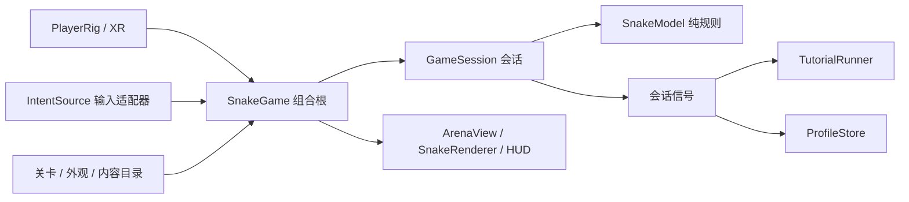

# 架构约定

工程采用 Godot 场景组合、Resource 内容配置和显式依赖。模块沿单一方向依赖，既保留编辑器工作流，也允许无场景、无头显测试规则。



## 职责与生命周期

| 模块 | 所有权与职责 | 禁止依赖 |
| --- | --- | --- |
| `SnakeModel` | 本轮蛇、占用格、可用食物格、得分、结束原因；按给定方向执行一格 | 节点、渲染、XR、输入设备、文件、墙钟 |
| `GameSession` | 开始 / 暂停 / 重开、倒计时、保持输入门控、移动时钟、语义事件 | 显示、硬件和存档实现 |
| `IntentSource` | 每帧当前方向；回中、松开、失追踪必须返回零 | 游戏规则、分数、存档 |
| `PlayerRig` | OpenXR 初始化、摄像机、控制器、手部诊断、焦点信号 | 游戏规则、关卡、存档 |
| `SnakeGame` | 注入配置和依赖、连接信号、转交命令、内容切换 | 具体碰撞算法与渲染网格算法 |
| 显示层 | 从会话读取状态，插值和视觉反馈，HUD 展示 | 向规则层反写蛇的位置或得分 |
| 教程 | 顺序消费 `move / stop / food / win`，输出步骤文本与完成事件 | 硬编码控制器、直接改变蛇 |
| 存档 | 版本化本地进度，事务式替换、备份恢复 | 每帧游戏时钟、XR |

`SnakeGame` 拥有这些实例；关卡切换先验证，再初始化显示并配置会话。共享 `.tres` 是创作数据，模型会复制关卡和每个机制资源，运行状态不能写回内容文件。纯规则可通过固定随机种子重放。

## 公共调用接口

```gdscript
# 场景入口：scenes/game/game.tscn 的根节点
var game: SnakeGame = ...
game.select_level("training")       # Error；未知 id 不改变当前关卡
game.select_skin("sunset")          # Error；规则不受外观影响
game.load_level(custom_level)       # 验证通过后才切换
game.set_input_source(custom_input) # 先暂停并清理旧输入

game.session.toggle_play()
game.session.restart()
game.session.pause()
```

规则 / 会话也可独立使用：

```gdscript
var session := GameSession.new()
var errors := session.configure(load("res://content/levels/classic.tres"), 42)
assert(errors.is_empty())
session.toggle_play()
session.submit_intent(Vector3i.RIGHT) # 当前保持状态
session.tick(delta)                  # 一帧一次，内部限制恢复帧的大 delta
session.submit_intent(Vector3i.ZERO)  # 立即冻结时钟和插值
```

`submit_intent()` 的方向是**房间局部网格轴**，只允许六个基向量或零。适配器先将头部相对输入转换到房间坐标。无效掉头会变为零，不沿旧方向行进。不得在另一层额外维护转向队列或自动移动定时器。

会话发布 `round_reset`、`step_committed`、`food_eaten`、`round_finished`、`phase_changed`、`intent_changed`、`input_reset_requested`。信号订阅者不在回调内递归重开或重新配置会话；需要切场景时使用延迟调用，避免重入。

`model.body` 等状态由模型拥有，显示和业务只能读取。`advance()` 用于明确执行一格及确定性测试；正常运行调用 `tick()`。格间插值保留已验收的 0.3.3 行为：逻辑步在段起点提交，视觉随后跟进，因此计分事件可能早于视觉到达；松手冻结剩余插值，转弯在下一格边界应用。这一语义应在改成连续路径运动时整体迁移，不能由单个输入适配器悄悄改变。

## 持久化与错误处理

`ProfileStore` schema 1 保存分关卡最高分、教程完成 id 和外观 id。文件写入临时路径，flush 后替换主文件，并保留 `.bak`；损坏主文件读取备份。没有自动上传、云同步或录音保存。教程、得分只在事件发生时写盘。

内容校验拒绝非法尺寸、不连续/重叠蛇身、非法初始方向、食物/障碍重叠、重复 id、空教程和无效机制参数。关卡容量上限暂为 4096 格，修改上限前必须重新测量渲染和内存预算。自定义 Resource 的深复制与状态隔离必须有回归测试。

## 工具约束

`tools/check_architecture.py` 检查核心、输入和设备层禁止依赖，以及资源路径有效性；`gdformat` / `gdlint` 固定版本。检查脚本有进程超时，并识别 Godot 退出码为 0 时的脚本错误。代码风格由 `.editorconfig` 和自动格式器维护。

场景组合与显式依赖参考 [Godot 4.4 场景组织指南](https://docs.godotengine.org/en/4.4/tutorials/best_practices/scene_organization.html)。
